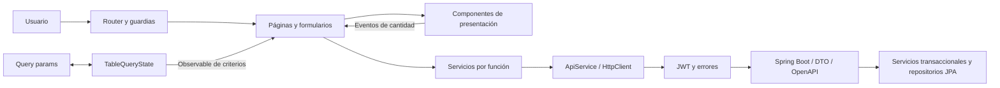

# Relación del material del curso con AquaX Angular

## Decisión

Se adaptó `aquax-frontend`. La aplicación existente ya usa Angular, formularios, servicios, JWT, guardias y el contrato real de AquaX; puede cubrir los temas del curso sin crear una segunda implementación. El material enseña arquitectura y comportamiento, no una identidad visual concreta. Por eso se conserva la presentación de AquaX y se refina su organización y funcionamiento.

Se leyeron los cinco PDF (108 páginas en conjunto) y se revisaron visualmente las diapositivas pertinentes, incluidos los ejemplos de código que están incrustados como imágenes. Los laboratorios y comandos dentro de los documentos se consideran ejemplos didácticos; no son autorización para publicar la aplicación ni para cambiar el dominio de AquaX por un catálogo de cursos.

## Matriz de correspondencia

| Material y páginas PDF                                                                    | Conceptos relevantes                                                                 | Situación revisada                                                                                  | Aplicación en AquaX                                                                                                                                              |
| ----------------------------------------------------------------------------------------- | ------------------------------------------------------------------------------------ | --------------------------------------------------------------------------------------------------- | ---------------------------------------------------------------------------------------------------------------------------------------------------------------- |
| [Fundamentos, semana07](C:/Users/thesa/Downloads/Sem07_Material.pdf), pp8–16              | Componentes, flujo de arranque, vista/lógica/estilos y encapsulación                 | Varias vistas extensas estaban dentro del archivo TypeScript                                        | Plantillas de páginas externas; tarjeta `ProductoCard` con HTML/SCSS propios; estilos globales para tema y elementos compartidos                                 |
| [Servicios y rutas](C:/Users/thesa/Downloads/Material.pdf), pp4–17                        | Servicios/data services, inyección, comunicación padre-hijo y estado compartido      | Algunas páginas dependían directamente del cliente genérico de la API                               | Servicios de catálogo, cuenta, dashboard y notificaciones; producto/cantidad entran al hijo y los cambios salen como eventos                                     |
| [Servicios y rutas](C:/Users/thesa/Downloads/Material.pdf), pp18–26                       | SPA, router, route params y query params                                             | Existían rutas y enlaces al pedido, pero las tablas no conservaban todos sus filtros                | Búsqueda, página, tamaño y orden se restauran desde la URL; enlaces de notificación conservan su función                                                         |
| [Angular y Spring Boot, semana09](C:/Users/thesa/Downloads/Sem09_Material.pdf), pp4–15    | HttpClient, Observables, interceptores, JWT, autorización y guardias                 | Ya implementados JWT, Bearer acotado y respuestas ProblemDetail                                     | Se mantienen, con servicios HTTP por función y pruebas que comprueban autorización y manejo de errores                                                           |
| [Angular y Spring Boot, semana09](C:/Users/thesa/Downloads/Sem09_Material.pdf), pp16–18   | Compilación y entornos                                                               | Había una configuración única de API                                                                | `environment.ts`, `environment.prod.ts` y sustitución explícita en `angular.json`; compilación de producción y guía de servidor SPA                              |
| [Paginación y calidad, semana11](<C:/Users/thesa/Downloads/Sem_11 Material.pdf>), pp6–13  | Contrato `content/page`, HttpParams, signals, debounce300, switchMap y estado en URL | Había páginas y búsqueda manual; no debounce ni filtros completos en URL                            | `TableQueryState` compartido por pedidos/usuarios/empleados, orden permitido, corrección directa de página fuera de rango y cancelación de consultas anteriores  |
| [Paginación y calidad, semana11](<C:/Users/thesa/Downloads/Sem_11 Material.pdf>), pp14–18 | OpenAPI/Swagger, validación, estados de UI, mantenimiento y Definition of Done       | Backend documentado y UI con estados/error/confirmación                                             | Se conserva el contrato del backend y se amplía la guía de integración y las regresiones de frontend                                                             |
| [JPQL y transacciones, semana12](<C:/Users/thesa/Downloads/Sem_12 Material.pdf>), pp4–13  | Named parameters, `@Transactional`, atomicidad y rollback                            | Los repositorios Java ya usan parámetros nombrados y los servicios de escritura son transaccionales | Angular confirma cambios después de una respuesta exitosa, conserva formularios ante fallos y no reintenta escrituras; el rollback se prueba y ejecuta en Spring |

Las páginas indicadas corresponden a la numeración física de cada PDF, incluida su portada.

## Arquitectura resultante



Ejemplo concreto de comunicación:

```html
<app-producto-card
  [producto]="product"
  [cantidad]="quantity(product.id)"
  (cantidadChange)="setQuantity(product.id, $event)"
/>
```

`ProductoCard` se encarga de mostrar el producto y emitir la cantidad. `PedidoForm` mantiene el carrito y el formulario. `CatalogoService` envía identificadores y cantidades. Spring obtiene los precios vigentes, calcula el total y confirma el pedido. El total del navegador es una estimación.

## Flujo de las tablas

Un enlace como `/panel/usuarios?page=2&size=25&texto=P%C3%A9rez&sort=nombre,asc` restablece la vista. Las páginas son base0 en la URL y en Spring; la UI presenta base1.

1. `ActivatedRoute` entrega los criterios y `TableQueryState` valida enteros, tamaño1–50 y campos/direcciones de orden.
2. El buscador espera300ms tras la última escritura. Buscar/Enter puede enviar de inmediato y reinicia la página.
3. Se actualiza la URL conservando los query params ajenos. Los cambios de página permiten volver con Atrás/Adelante; escribir no crea una entrada de historial por cada tecla.
4. `switchMap` cancela la lectura anterior. `catchError` está dentro de la petición para que un fallo no termine permanentemente el flujo.
5. La tabla muestra carga, resultado, vacío o error. Si el índice ya no existe, se navega directamente a la última página válida.
6. La destrucción de la página termina las suscripciones con `takeUntilDestroyed`.

El estado en la URL incluye `completados` en pedidos. Los enlaces con `pedido` desde notificaciones buscan el pedido operativo o completado y abren su detalle/historial.

## Equivalencias con Angular actual

Algunas diapositivas muestran una organización basada en `AppModule`, `HttpClientModule`, decoradores y guardias de clase. El proyecto mantiene Angular22 standalone, con estas equivalencias:

| Ejemplo del material              | Implementación del proyecto                                                              |
| --------------------------------- | ---------------------------------------------------------------------------------------- |
| `AppModule` y `bootstrapModule`   | `bootstrapApplication(App, appConfig)` y dependencias en `imports/providers`             |
| `HttpClientModule`                | `provideHttpClient(withInterceptors(...))`                                               |
| `@Input` / `@Output`              | `input()` / `output()`                                                                   |
| Guard/interceptor de clase        | `CanActivateFn` / `HttpInterceptorFn`                                                    |
| Observable y servicio compartido  | RxJS para HTTP/consultas y signals para estado de vista/sesión                           |
| Archivo environment de producción | `fileReplacements` explícito; el nombre del archivo no activa la sustitución por sí solo |

La [documentación oficial recomienda standalone para código nuevo](https://angular.dev/guide/ngmodules/faq). La [configuración de entornos](https://angular.dev/tools/cli/environments) define las sustituciones de compilación. Las [guardias](https://angular.dev/guide/routing/route-guards) mejoran la navegación, mientras Spring sigue autorizando cada endpoint.

Estas equivalencias conservan los objetivos del curso y permiten explicar el proyecto con su versión instalada. No se requiere migrar a módulos para demostrar componentes, inyección o routing.

## Alcance de la semana12

`UsuarioRepository`, `EmpleadoRepository` y `PedidoRepository` ya declaran consultas con `@Query` y `@Param`. `PedidoService` guarda pedidos e historial/notificaciones dentro de métodos `@Transactional`; varias lecturas usan `readOnly=true` y carga explícita de relaciones.

Esto se comprobó leyendo el código Java. No se ejecutaron nuevas pruebas de base de datos ni se certificó rendimiento SQL en esta adaptación de frontend. Angular no puede garantizar un rollback ni simularlo revirtiendo un objeto local. Tampoco se cambian las propagaciones a `REQUIRES_NEW`: la auditoría actual registra operaciones confirmadas junto al pedido y ese contrato debe conservar su atomicidad.

Las nuevas pruebas de cuenta comprueban que un error de escritura no actualice la identidad ni aplique preferencias, que termine la carga y que una contraseña solo cierre la sesión después de una confirmación exitosa. Son comprobaciones de interfaz, no pruebas de rollback de base de datos.

## Verificación y entrega

Ejecutar desde PowerShell:

```powershell
Set-Location 'C:\Proyecto_Soluciones Web\aquax-frontend'
npm.cmd test -- --watch=false
npm.cmd run build
npm.cmd start
```

Las pruebas automatizadas usan respuestas controladas y verifican el comportamiento real de formularios, componentes y router. El resultado final se registra en `PRUEBAS_INTEGRACION.md`.

El recorrido completo contra Spring, la persistencia tras reiniciar y la comprobación real de rollback requieren el backend iniciado y una base de pruebas. La publicación no se realiza como parte de esta adaptación local.

### Resultado verificado

Compilación de producción correcta. Suite final: **61 pruebas aprobadas en 17 archivos, sin fallos**. Se incluyen pruebas DOM de entradas/salidas del componente de producto y pruebas de navegación/búsqueda con respuestas controladas.

La revisión visual adicional quedó pendiente porque la revisión automática de permisos falló por un límite de uso al iniciar el servidor local. Esto no fue un rechazo de seguridad del proyecto. No se ejecutaron cambios adicionales en los PDF ni en la base habitual del backend.
